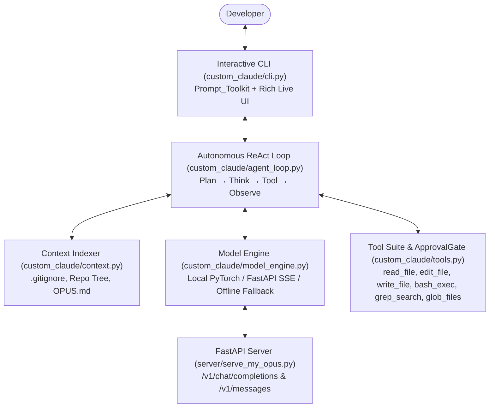

# Custom Claude Code (`custom-claude-code`)

A terminal-native autonomous coding agent CLI (`ccode`) built in Python with `rich` and `prompt_toolkit`, backed by a local PyTorch & FastAPI inference runtime (`My-Opus`), surgical unified-diff editing, human-in-the-loop safety gates, AST reverse-engineering utilities, and automated self-improvement pipelines.

---

## System Architecture



---

## Core Modules

- **`custom_claude/`**:
  - `cli.py`: Interactive REPL with streaming markdown, `<thinking>` extended-thinking panels, command autocompletion, and slash commands (`/init`, `/test`, `/model`, `/compact`, `/yolo`, `/break-and-rebuild`, `/reverse-engineer`).
  - `agent_loop.py`: Multi-turn ReAct execution loop with autonomous `/test` verification cycles.
  - `tools.py`: Line-numbered `read_file`, strict surgical `edit_file` with colored unified diffs, `write_file`, cross-platform `bash_exec`, `grep_search`, `glob_files`, and interactive `ApprovalGate` (`[Y]es / [N]o / [A]lways allow`, or `--yolo`).
  - `context.py`: `.gitignore`-aware repository tree indexer and `OPUS.md` project memory generator.
  - `model_engine.py`: Unified `ModelEngine` supporting local `CustomOpusModel` PyTorch weights, OpenAI/Anthropic SSE HTTP endpoints, and deterministic offline fallback.
- **`server/`**: `serve_my_opus.py` — FastAPI server exposing streaming `/v1/chat/completions` and `/v1/messages` endpoints.
- **`rebuild_engine/`**: Adversarial red-teaming (`breaker.py` with 20 synthetic bug traps and `ASTMutator`), diagnostic trace synthesis (`diagnose_and_synth.py`), and DPO reasoning rebuilder (`rebuilder.py`).
- **`reverse_eng/`**: AST skeleton `context_packer.py`, `sys.settrace` variable-divergence `trace_synthesizer.py`, and shared-weight `RecurrentOpusModel` with `CFGLogitMasker` (`recurrent_opus.py`).

---

## Quick Start

### 1. Install
```bash
pip install -e ".[dev]"
```

### 2. Run the Automated Test Suite
```bash
pytest tests -q
```

### 3. Launch the Local FastAPI Model Server & CLI
```bash
# Terminal 1: start the local OpenAI/Anthropic-compatible server
uvicorn server.serve_my_opus:app --host 127.0.0.1 --port 8080

# Terminal 2: launch ccode
ccode
```

---

## License
MIT License — see [LICENSE](LICENSE).
